<p align="center">
  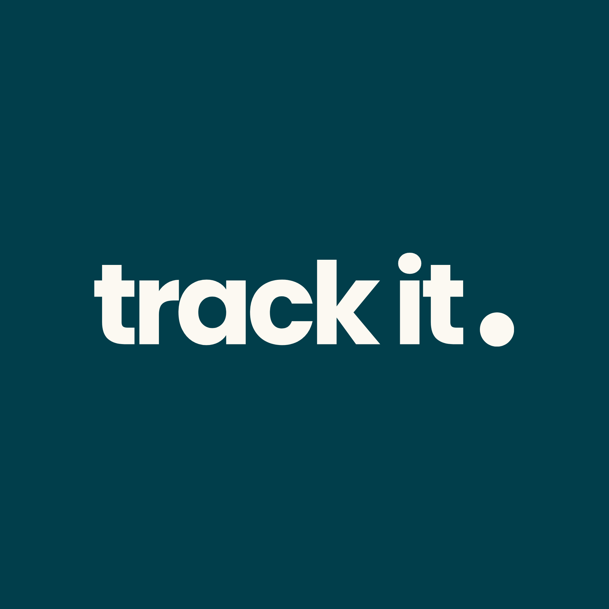
</p>

<h1 align="center">track it.</h1>

<p align="center"><b>Multiple trackers for everyday productivity.</b></p>

<p align="center">
  An Android app that brings your coding practice, your tasks and your money into one calm, glassy home —
  built with Jetpack Compose, Material You and a Liquid&nbsp;Glass–inspired interface.
</p>

<p align="center">
  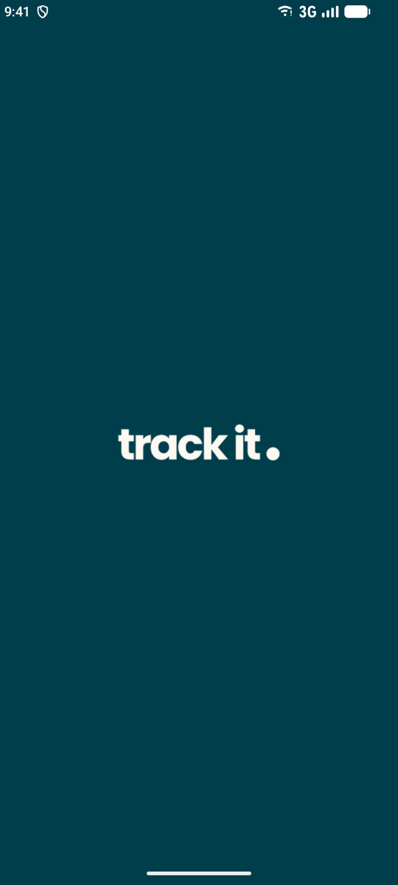
  &nbsp;
  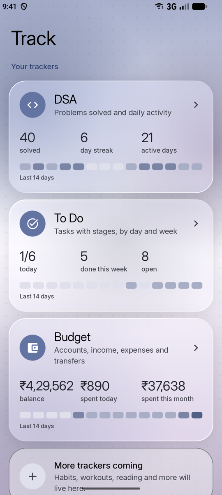
  &nbsp;
  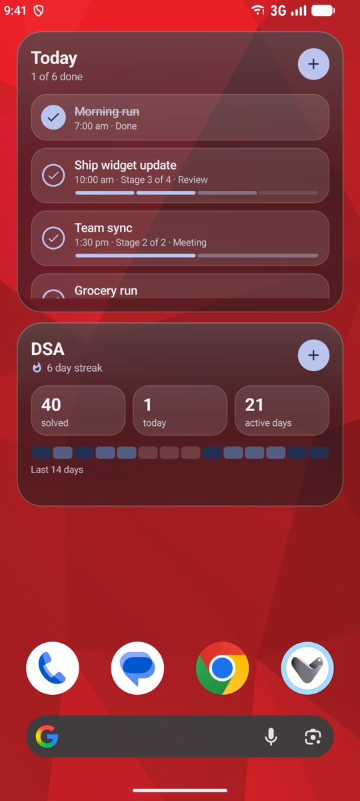
</p>

---

## Contents

- [Trackers](#trackers)
  - [DSA](#dsa)
  - [To Do](#to-do)
  - [Budget](#budget)
- [Home-screen widgets](#home-screen-widgets)
- [Design](#design)
- [Tech stack](#tech-stack)
- [Project structure](#project-structure)
- [Getting started](#getting-started)
- [Adding a new tracker](#adding-a-new-tracker)
- [Credits](#credits)

---

## Trackers

The home screen lists every tracker as a glass card with an at-a-glance summary and a 14-day activity strip.
Tap a card to open the tracker.

### DSA

Track the data-structures & algorithms problems you solve and keep your streak alive.

<p>
  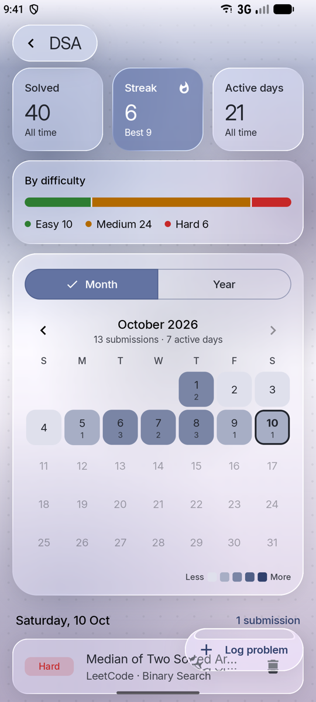
  &nbsp;
  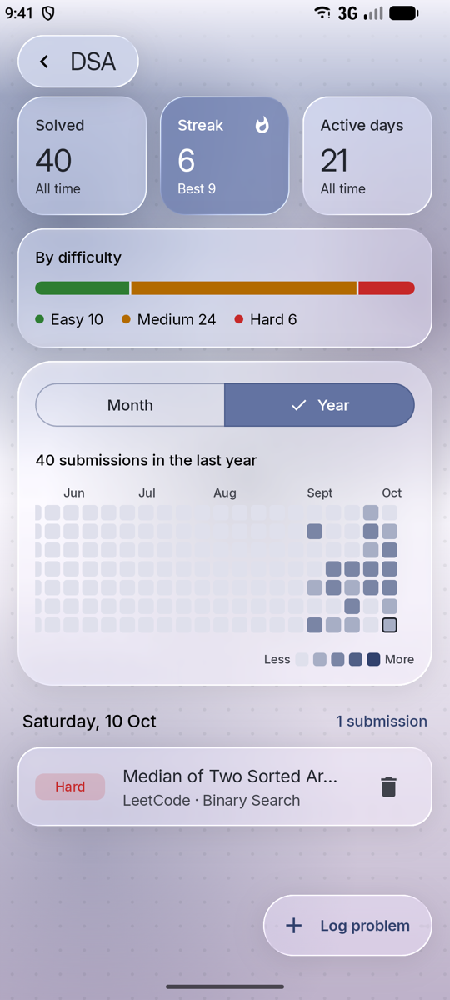
</p>

- **Log problems** with title, platform (LeetCode, Codeforces, CodeChef, GFG, HackerRank, AtCoder…), difficulty, topic and date.
- **Stats** — total solved, current streak (with best streak), active days and an Easy / Medium / Hard breakdown.
- **Activity calendar** — a month view where each day shows its submission count and a heat colour, plus a GitHub-style **year heatmap**.
- Tap any day to see what you solved; delete with **Undo**.

### To Do

Plan your day and week, and move tasks forward stage by stage.

<p>
  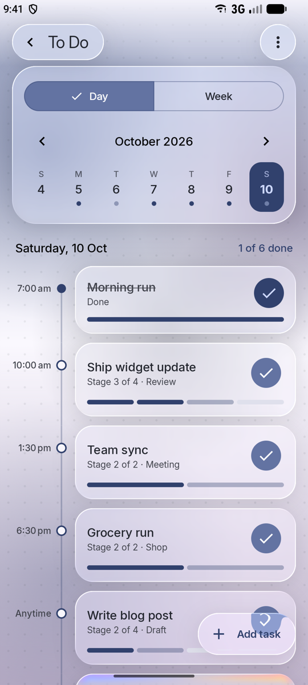
  &nbsp;
  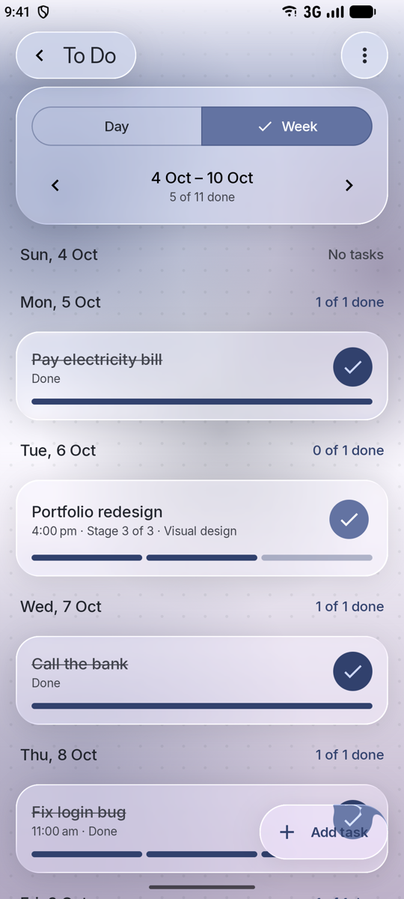
  &nbsp;
  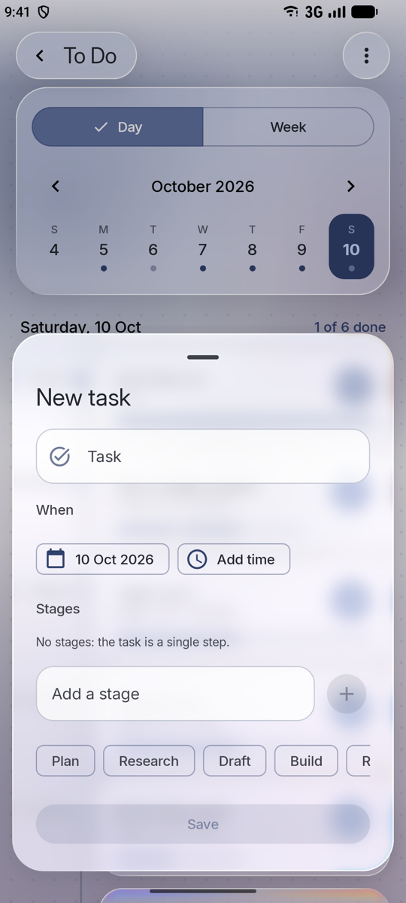
</p>

- **Tasks with stages** — give a task ordered steps (e.g. *Plan → Draft → Review → Publish*). The ✓ button completes the current stage; the task is done when every stage is.
- **Day timeline** (primary) — tasks laid out on a vertical timeline by time, or under *Anytime*.
- **Week view** (primary) — every day of the week with its progress.
- **Month & Year overviews** (from the ⋯ menu) — a calendar of task counts and twelve month tiles with completion bars.
- Optional date and time per task, stage suggestions, and delete with **Undo**.

### Budget

Accounts, income, expenses and transfers — with grand totals you define.

<p>
  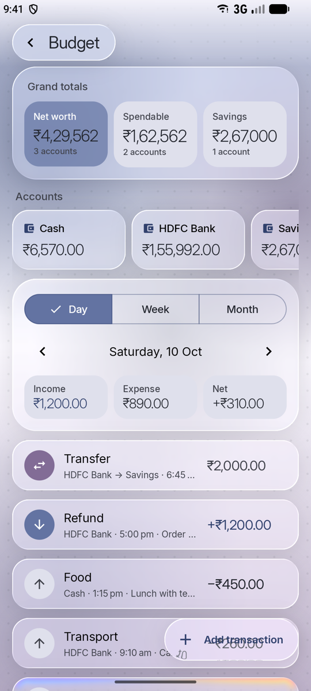
  &nbsp;
  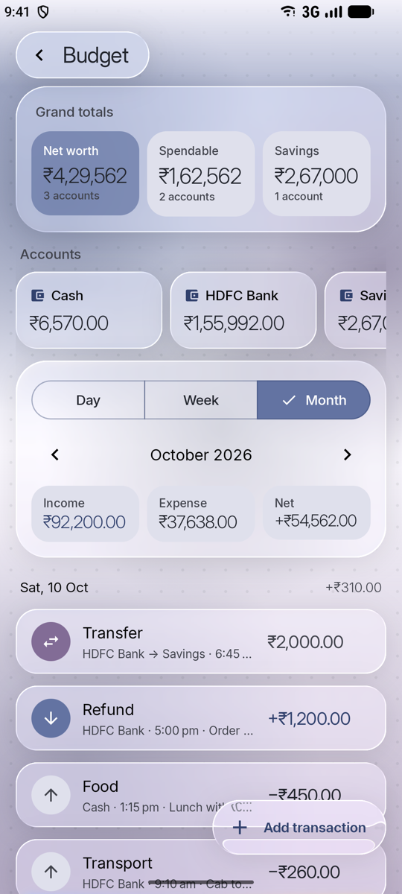
  &nbsp;
  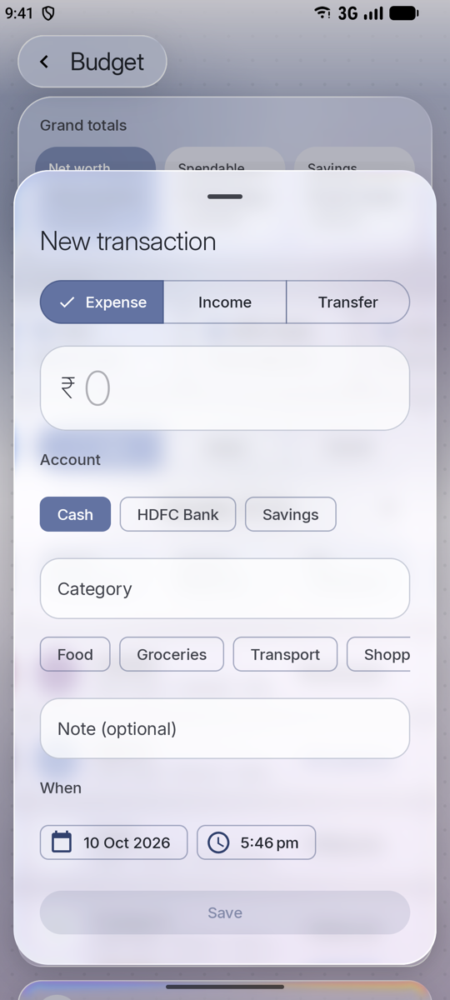
</p>

- **Income, expenses and transfers** between any two accounts. Transfers move money without counting as income or spending.
- **Multiple accounts**, each with an opening balance and a live balance.
- **Three grand totals** (default *Net worth*, *Spendable*, *Savings*) — rename them and choose exactly which accounts count towards each.
- **Day / Week / Month** transaction lists with income, expense and net totals for every period and every day.
- Amounts are stored in minor units (paise / cents) so totals never drift, and are shown in your device's currency.
- Thin, light typography throughout — no heavy bold numbers.

---

## Home-screen widgets

<p>
  
  &nbsp;
  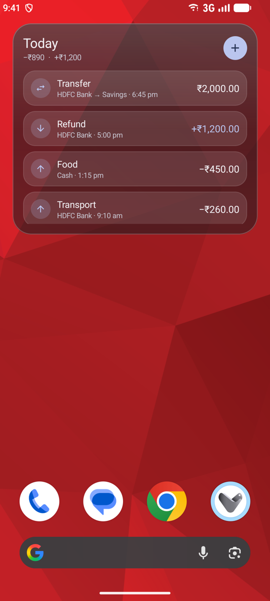
</p>

| Widget | What it shows | Actions |
|---|---|---|
| **Today's tasks** | Today's to-dos with their current stage and stage progress | ✓ completes a stage **right on the home screen**; ＋ opens the *New task* sheet |
| **DSA progress** | Streak, problems solved, solved today, active days and a 14-day strip | ＋ opens the *Log problem* sheet |
| **Today's transactions** | Today's spend and income and every transaction | ＋ opens the *New transaction* sheet |

Widgets refresh instantly when data changes (in the app or from the widget) and adapt to light and dark mode.

---

## Design

- **Liquid Glass** — cards, the floating top bar, buttons and bottom sheets blur and refract the content behind them
  (via [Backdrop](https://github.com/Kyant0/AndroidLiquidGlass)). Clear glass for floating buttons, frosted glass for sheets.
- **Material You** — colours come from your wallpaper (Android 12+), with a soft colourful backdrop behind the glass.
- **Inter** typeface — an open-source alternative to SF Pro, using *Inter Display* for headings and *Inter* for text.
- Quick shared-axis transitions between screens and a branded splash screen.
- Widgets recreate the glass look with layered translucent panels (launchers don't support live blur behind widgets).

---

## Tech stack

| Area | Library |
|---|---|
| Language | Kotlin 2.2 |
| UI | Jetpack Compose, Material 3 (BOM 2026.02) |
| Glass effects | [Backdrop](https://github.com/Kyant0/AndroidLiquidGlass) 1.0.6 |
| Navigation | Navigation Compose 2.10 |
| Persistence | Room 2.8 (with migrations) + KSP |
| Architecture | MVVM — ViewModels exposing `StateFlow`, repositories over Room DAOs, manual DI (`AppContainer`) |
| Widgets | Jetpack Glance 1.2 |
| Splash | AndroidX Core SplashScreen 1.2 |
| Dates | `java.time` with core library desugaring |
| Build | Android Gradle Plugin 9.4, Gradle 9.6 |

**Requirements:** min SDK 24 (Android 7.0), target/compile SDK 37.
Blur needs Android 12+ and refraction Android 13+; older devices get a frosted, untinted fallback.

---

## Project structure

```
app/src/main/java/com/uzxsan/dev/track/
├── MainActivity.kt          # Splash, edge-to-edge, shared glass backdrop, widget deep links
├── TrackApplication.kt      # App container, first-run defaults, widget updater
├── data/                    # Room database, migrations, AppContainer
├── home/                    # Home screen, tracker registry, home summaries
├── navigation/              # NavHost, routes, transitions, LaunchRequest (track:// deep links)
├── dsa/                     # DSA tracker (data, stats, screen, log sheet)
├── todo/                    # To Do tracker (data, stage logic, screen, task card, add sheet)
├── money/                   # Budget tracker (data, balance & period logic, screen, sheets)
├── widget/                  # Glance widgets and shared widget glass parts
└── ui/
    ├── components/          # Glass surfaces, top bar, FAB, sheets, calendar, text field
    └── theme/               # Colours, accent helpers, Inter typography

branding/                    # Source logo + script that generates the icons and splash
Docs/                        # Feature specs and README screenshots
```

---

## Getting started

1. Clone the repository and open it in **Android Studio** (a recent version with AGP 9 support).
2. Let Gradle sync, then run the **app** configuration on a device or emulator.

From the command line:

```bash
./gradlew :app:assembleDebug          # build the debug APK
./gradlew :app:installDebug           # install on a connected device
./gradlew :app:testDebugUnitTest      # run the unit tests
```

The unit tests cover the core logic of every tracker — DSA streaks, To Do stage progression and weeks,
and Budget balances, grand totals, period ranges and amount parsing.

### Regenerating the app icon

The launcher icons and splash logo are generated from `branding/trackit-logo.png`:

```bash
swift branding/make_icons.swift       # run from the project root (macOS)
```

---

## Adding a new tracker

1. Add its entities and DAO under a new package, register them in `TrackDatabase`, bump the version
   and add a migration in `data/Migrations.kt`.
2. Expose a repository from `AppContainer`.
3. Build the screen with the shared glass components (`GlassTopBar`, `GlassSurface`, `GlassExtendedFab`, `GlassBottomSheet`).
4. Add a route in `navigation/TrackNavHost.kt` and an entry in `home/Trackers.kt`, plus a summary in `HomeViewModel`.

---

## Credits

- **[Inter](https://rsms.me/inter/)** by Rasmus Andersson — SIL Open Font License 1.1 (bundled at `app/src/main/assets/licenses/Inter-OFL.txt`).
- **[Backdrop](https://github.com/Kyant0/AndroidLiquidGlass)** by Kyant — Apache License 2.0.
- Icons are Material Symbols vector paths.
- Built with Jetpack Compose, Room, Glance and Material 3.
